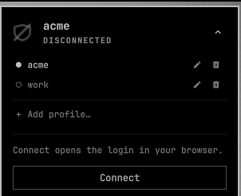
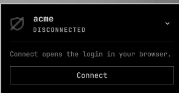
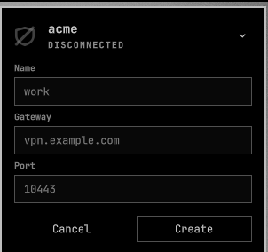

# FortiVPN for Omarchy

A Fortinet SSL VPN in the Omarchy bar: whether the tunnel is up, the address it
gave you, how long it has been up and what has gone through it — and connect,
disconnect and switch VPNs without leaving the bar.



Built for gateways that authenticate through SAML/SSO, where a browser login
and a phone confirmation stand between you and the tunnel. One click starts the
tunnel and opens that login; the icon fills in as soon as it lands.

## What you get

| | |
|---|---|
|  | **The tunnel at a glance.** A filled shield means protected, a hollow one means it is not. When connected the panel shows the address, the user and the traffic; when it is not, it says why in words rather than in systemd's vocabulary. |
|  | **As many VPNs as you have.** Every profile on the machine is found on its own. The active one is the panel's headline; switching takes down the live tunnel and brings up the new one in a single click. |
|  | **Set one up from here.** Name, gateway, port. Changing and removing a profile are on the same list, behind the pencil and the bin. |

## Install

```bash
omarchy plugin add https://github.com/zangetsu02/omarchy-fortivpn --enable --yes
```

Then the system side, once per VPN:

```bash
sudo pacman -S openfortivpn
sudo ~/.config/omarchy/plugins/io.github.zangetsu02.fortivpn/scripts/setup-openfortivpn \
  work vpn.example.com 10443
```

That writes the profile, a systemd drop-in and a polkit rule scoped to that one
unit, and checks the gateway's certificate chain while it is there. Nothing to
put in `shell.json`: the widget finds the profile by itself.

To hack on it instead, clone anywhere and symlink — Omarchy follows the link, so
edits apply live:

```bash
git clone https://github.com/zangetsu02/omarchy-fortivpn ~/Workspaces/omarchy-fortivpn
ln -s ~/Workspaces/omarchy-fortivpn ~/.config/omarchy/plugins/io.github.zangetsu02.fortivpn
omarchy-shell shell rescanPlugins
omarchy plugin enable io.github.zangetsu02.fortivpn
```

## Remove

```bash
# 1. Every VPN profile this plugin set up, one at a time.
sudo ~/.config/omarchy/plugins/io.github.zangetsu02.fortivpn/scripts/remove-openfortivpn work

# 2. The widget.
omarchy plugin remove io.github.zangetsu02.fortivpn
```

Step 1 stops the unit and deletes the four files the setup wrote: the config,
the certificate bundle, the systemd drop-in and the polkit rule. Run it before
step 2, or those files stay behind after the plugin is gone. Step 2 also takes
the widget out of `shell.json`.

Removing the plugin never touches `openfortivpn` itself, or anything you wrote
under `/etc/openfortivpn` by hand.

## Requirements

| | |
|---|---|
| **openfortivpn 1.21+** | For the `--saml-login` flag. This is the backend that can raise a tunnel from the bar. `pacman -S openfortivpn` |
| **FortiClient** (optional) | `forticlient-vpn` from the AUR, with `forticlient.service` running. An alternative backend that can report and disconnect, but hands the login to its own GUI. |
| **polkit** | Already on Omarchy. The setup script adds one rule so connecting does not ask for a password every time. |
| **Node** (development only) | `scripts/selftest` uses it to exercise the parsers. Not needed to run the widget. |

Licensed under the MIT License — see [LICENSE](LICENSE).

## What needs root, and what does not

The widget runs as you and never writes to `/etc`. Three things cross a
privilege boundary, and you see each one happen:

| | |
|---|---|
| **Installing openfortivpn** | `sudo pacman -S openfortivpn`, typed by you, once. The plugin never installs or upgrades software. |
| **Creating or changing a profile** | `setup-openfortivpn` under `sudo`. The panel does not run it: it opens a terminal with the command filled in, so the password and the output stay with you. |
| **Removing a profile** | `remove-openfortivpn` under `sudo`, the same way, after a confirmation in the panel. |

Connecting and disconnecting need no password, and no root. That is what the
polkit rule is for, and it is deliberately narrow: **one rule per profile**,
matching a single systemd unit, four verbs (`start`, `stop`, `restart`,
`reset-failed`), and only a local active session belonging to the user who ran
the setup. It grants nothing else, and connecting still requires completing the
SSO login in a browser.

While running, the widget reads `systemctl is-active`/`show` for its own unit
and the byte counters under `/sys/class/net`. It starts and stops that one unit
and nothing else. The only configuration it writes on its own is its entry in
`~/.config/omarchy/shell.json`, recording which profile you picked.

The name, gateway and port you type become words in a command line, so they are
checked against strict shapes before they reach a shell —
`Model.js:profileFormError` and the name check in `remove-openfortivpn`.
`./scripts/selftest` exercises both with inputs like `work;rm -rf /`.

## Profiles

A profile is one `/etc/openfortivpn/<name>.conf` and the systemd instance that
reads it. They are **discovered, not configured**: a profile made with
`setup-openfortivpn` appears in the panel without anyone editing `shell.json`.

The active profile is the panel's headline, and the chevron beside it opens the
list. Switching while a tunnel is up tears the old one down first — one ppp
route table, one gateway at a time — and then connects the new profile. The
choice is written back to `shell.json`, which is what makes it survive a
restart.

### Adding, changing and removing from the panel

All three write to `/etc` and install or delete a polkit rule, which is not work
a bar widget may do on its own. The panel hands a prepared command to a
terminal instead: your password stays there, and so does the script's output
when something goes wrong.

Changing a profile is the same form with the name fixed, because
`setup-openfortivpn` overwrites its own files — saving is creating again.
Renaming is not an edit, since it would leave the old profile in place.

### Why the login URL lives in the systemd drop-in

Each profile needs its own login page, and the config that names the gateway is
mode 600 root-only — unreadable by the widget. So `setup-openfortivpn` records
it where the widget *can* read it:

```ini
# /etc/systemd/system/openfortivpn@work.service.d/override.conf
Environment=FORTIVPN_SAML_URL=https://vpn.example.com:10443/remote/saml/start?redirect=1
```

A profile without that line still connects; it just cannot open the login page
by itself, and the edit form opens with its gateway blank. Re-running the setup
adds it.

### Setting one up by hand

Everything here is machine-specific and lives outside this repo.

**1. A profile.** `/etc/openfortivpn/<name>.conf`, mode 600:

```ini
host = vpn.example.com
port = 10443
saml-login = 8020
```

If the gateway does not serve its intermediate certificates — openssl says
`unable to verify the first certificate` — do not pin the fingerprint with
`trusted-cert`, because that breaks on every certificate renewal. Fetch the
intermediate named in the leaf's *CA Issuers* field, concatenate it with the
system CA bundle, and point `ca-file` at the result. The setup script does
exactly this, and refuses to install a bundle that does not complete the chain.

**2. A longer start timeout**, at
`/etc/systemd/system/openfortivpn@<name>.service.d/override.conf`, because a
person has to complete an SSO login inside systemd's default 90 seconds:

```ini
[Service]
TimeoutStartSec=300
Restart=no
```

`Restart=no` is not optional. The packaged template ships `Restart=on-failure`,
so a profile without this drop-in retries a failing tunnel in a loop until it
hits the start limit — and each retry would silently demand a fresh interactive
login.

**3. A polkit rule**, so connecting does not ask for a password every time.
Scope it to the one unit and the four verbs:

```javascript
polkit.addRule(function(action, subject) {
    if (action.id !== "org.freedesktop.systemd1.manage-units") return;
    if (!subject.local || !subject.active) return;
    if (subject.user !== "<your-user>") return;
    if (action.lookup("unit") !== "openfortivpn@<name>.service") return;
    var verb = action.lookup("verb");
    if (verb === "start" || verb === "stop" || verb === "restart" || verb === "reset-failed") {
        return polkit.Result.YES;
    }
});
```

This grants no general root access, and connecting still requires completing the
SSO login in a browser. `reset-failed` belongs in the list because a unit that
hit its start limit refuses every further start until the failure is cleared,
which would otherwise leave the connect button dead.

**4. Nothing else**, as long as the unit follows the `openfortivpn@<name>`
convention. A unit named outside it can still be driven, named explicitly in
`~/.config/omarchy/shell.json`:

```json
{
  "id": "io.github.zangetsu02.fortivpn",
  "openfortivpnUnit": "my-vpn@<name>",
  "samlUrl": "https://vpn.example.com:10443/remote/saml/start?redirect=1"
}
```

## Controls

| Action | Mouse | Keyboard (panel open) |
|---|---|---|
| Open the panel | Left click | — |
| Connect / disconnect | Right click | `Enter`, or `c` / `d` |
| Refresh now | Middle click | `r` |
| Show the profile list | Chevron in the panel | `p` |
| Switch profile | Click a profile | `1`–`9` |
| Add a profile | "Add profile…" | `a` |
| Change a profile | Pencil on its row | `e` (the active one) |
| Remove a profile | Bin on its row | `x` (the active one) |

## Settings

Every key is optional and goes on the widget's entry in
`~/.config/omarchy/shell.json`.

| Key | Default | Meaning |
|---|---|---|
| `backend` | `auto` | `auto`, `forticlient`, or `openfortivpn`. |
| `activeProfile` | `""` | Which discovered profile to drive. Written for you when you pick one. |
| `openfortivpnUnit` | `""` | Only for a unit outside the `openfortivpn@<name>` convention. |
| `samlUrl` | `""` | Fallback login URL for profiles whose drop-in records none. |
| `browserCommand` | `omarchy-launch-browser` | Opens the login page. |
| `refreshIntervalSec` | `5` | Poll interval; the duration ticks locally between polls. |
| `hideWhenDisconnected` | `false` | Hide the icon while the tunnel is down. |
| `notifyOnDrop` | `true` | Notify on an unrequested drop; a disconnect you asked for stays silent. |
| `notifyOnConnect` | `false` | Notify when the tunnel comes up. |
| `cliPath` | `""` | FortiClient backend only. Empty means look on `PATH`. |
| `guiCommand` | `/opt/forticlient/gui/FortiClient` | FortiClient backend only. |

## IPC

```bash
omarchy-shell fortivpn status        # current state label
omarchy-shell fortivpn backend       # which backend is active
omarchy-shell fortivpn profiles      # discovered profiles, one per line
omarchy-shell fortivpn profile work  # switch to a profile, disconnecting first
omarchy-shell fortivpn refresh       # poll now
omarchy-shell fortivpn connect       # connect, or open the GUI
omarchy-shell fortivpn disconnect    # tear the tunnel down
omarchy-shell fortivpn toggle        # open/close the panel
```

Changing the set of IPC functions a plugin exposes needs `omarchy restart
shell`; a hot reload keeps serving the old registration.

## Two backends, one widget

Which backend you get decides whether connecting is one click or a handoff.

| | FortiClient | openfortivpn |
|---|---|---|
| Status | `fortivpn status` | systemd unit + ppp interface |
| Connect | opens the FortiClient GUI | starts the unit, opens the login page |
| Disconnect | `fortivpn disconnect` | stops the unit |
| Needs root | no | yes, via a scoped polkit rule |
| Profiles | not supported | yes |

### Why FortiClient cannot connect from the bar

When the VPN authenticates through SAML/SSO — a browser login, confirmed in an
authenticator app — that flow belongs to the FortiClient GUI and tray.
`fortitray` holds the `xdg-open` call and the daemon owns the
`/remote/saml/login` endpoints.

The `fortivpn` CLI has no part in it. Its only auth flags are `--username`,
`--password` and `--save-password`, and an SSO profile is not even visible to
`fortivpn list` — it lives in the GUI's store. FortiClient's internal IPC is
nanomsg over sockets with hashed names, which is not something to build on.

So with that backend, **Connect hands off to the GUI**, and the widget starts
polling briskly so the icon turns the moment the login lands. openfortivpn
reimplements the same protocol and exposes that login as `--saml-login`, which
is why it can do the whole thing from the bar.

### One parser, two backends

Both report through `Model.js`, because
[`scripts/openfortivpn-status`](scripts/openfortivpn-status) prints the same
`Key: value` shape that `fortivpn status` does:

```
Status: Connected
VPN name: work
IP: 10.0.0.42
Sent bytes: 8111
Recv bytes: 147
Duration: 00:02:23
```

Adding a third backend means writing one more script, not touching the parser.

### The four states

FortiClient's naming is not self-evident, and `Model.js` maps it:

| Reported | Widget shows | Notes |
|---|---|---|
| `Connected` | Connected | Filled shield |
| `Connecting` | Connecting… | Shield breathes |
| `Not Running` | Disconnected | The normal idle state |
| `Disconnected` | Disconnected | Only flashes by during teardown |

## Development

```bash
./scripts/selftest          # discovery, both parsers, and the input guards
omarchy plugin validate .   # manifest against the Omarchy schema
```

The self-check covers the parts that fail silently: which files count as a
profile, how a profile line and a login URL are read back, and whether the two
places that accept typed input refuse what would reach a shell. Those values
become words in a command line, so `work;rm -rf /` is among the cases.

| File | Role |
|---|---|
| `manifest.json` | Plugin metadata and settings schema |
| `Model.js` | Parses the shared status format and the profile list; formats bytes and durations |
| `Service.qml` | Backend and profile selection, polling, connect and disconnect, notifications |
| `Panel.qml` | Bar icon, panel, profile list and the new-profile form |
| `FortiVpnIcon.qml` | Shield glyph, filled when protected |
| `scripts/openfortivpn-status` | Reports a unit in the shared format; `--list` discovers profiles |
| `scripts/setup-openfortivpn` | Provisions a profile: config, chain, drop-in, polkit rule |
| `scripts/remove-openfortivpn` | Tears one back down, unit first |
| `scripts/selftest` | The checks above |

## License

MIT — see [LICENSE](LICENSE).
